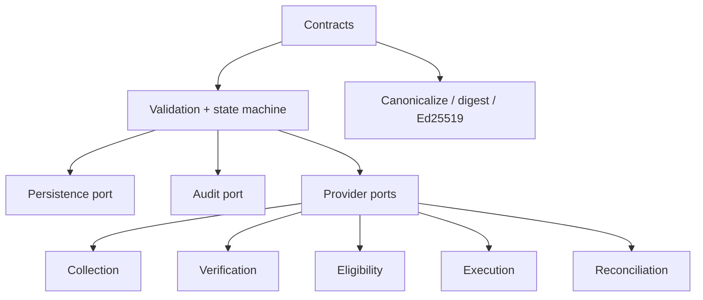

# Architecture

HBIEPA is independently buildable and deployable. It contains its own envelope, policy, state-machine, provider-port, persistence-port, audit-port, and simulation contracts. It imports nothing from HomeBound and does not access its production services, data, credentials, treasury, or workers.

The core makes no provider HTTP call. In later stages, adapters remain outside the policy core and expose typed results, including `AMBIGUOUS` and `UNSUPPORTED_OPERATION`. An ambiguous external outcome enters `EXCEPTION`; retries require idempotency keys, resource retrieval, and an explicit recovery policy.

The production safety boundary is structural: `ExecutionConstraint.simulationOnly` is literally `true`; configuration has no live alternative; and every supplied adapter is an unsupported placeholder. A future live-capable code path must be a separately reviewed stage and cannot be activated by changing an environment variable.

## Stage 1A local verification architecture

`SqliteDurableLedger` is the Stage 1A development persistence implementation. Its WAL-backed local file is independent of HomeBound and has no network database dependency. The loopback receiver binds only to `127.0.0.1`; it needs an explicitly authorised temporary HTTPS tunnel before PayPal can reach it. A webhook is evidence only: receipt, signature verification, and independent retrieval do not create an authorisation.
