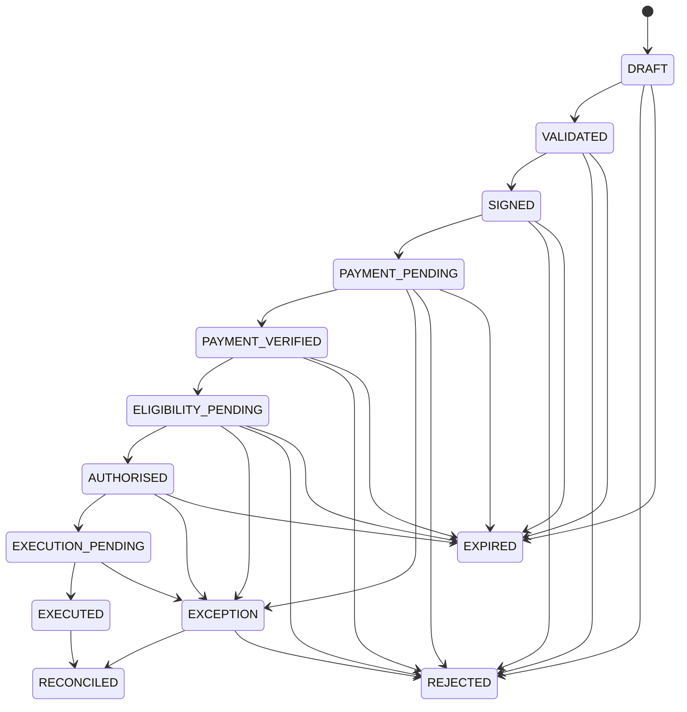

# State Machine

`PAYMENT_VERIFIED` means independently retrieved evidence satisfies payment identity/status/amount/currency conditions. It does not mean payout authority. `ELIGIBILITY_PENDING` evaluates policy, funding-bridge status, beneficiary/destination constraints, expiry, signature, human approval, and single-use availability. Only then may an independent authorisation be created.

`EXCEPTION` is mandatory for a provider timeout, conflict, unknown response, duplicated execution uncertainty, failed retrieval, or contradictory evidence. It cannot automatically transition to execution. Terminal/restricted states fail closed. Implementation must use optimistic revision/state compare-and-set or serializable transactions.

## Payment, funding, and payout facts are distinct

| Fact | Meaning | Does it permit the next fact? |
| --- | --- | --- |
| Payment authorised | Payer funds may be held under provider rules | No capture/payout implication |
| Payment captured | Provider accepted a capture request | No completion/availability implication |
| Capture completed | Retrieved capture has a completed status | No funds-availability or payout implication |
| Funds available | Provider/account evidence says funds are usable | No external-payout eligibility implication |
| Funds eligible for payout | Product/account/programme rules permit proposed payout | No authorisation implication |
| Funds allocated to payout provider | Separate treasury/funding bridge has allocated funds | No execution implication |
| Payout authorised | HBIEPA's one-time record satisfies policy | May request execution, once |
| Payout executed | Provider/mock accepted or reported its action | No reconciliation-finality implication |
| Payout reconciled | Evidence records a resolved terminal outcome | Terminal business evidence |

Stage 0 records only the model; it does not assert any actual provider or treasury fact.
